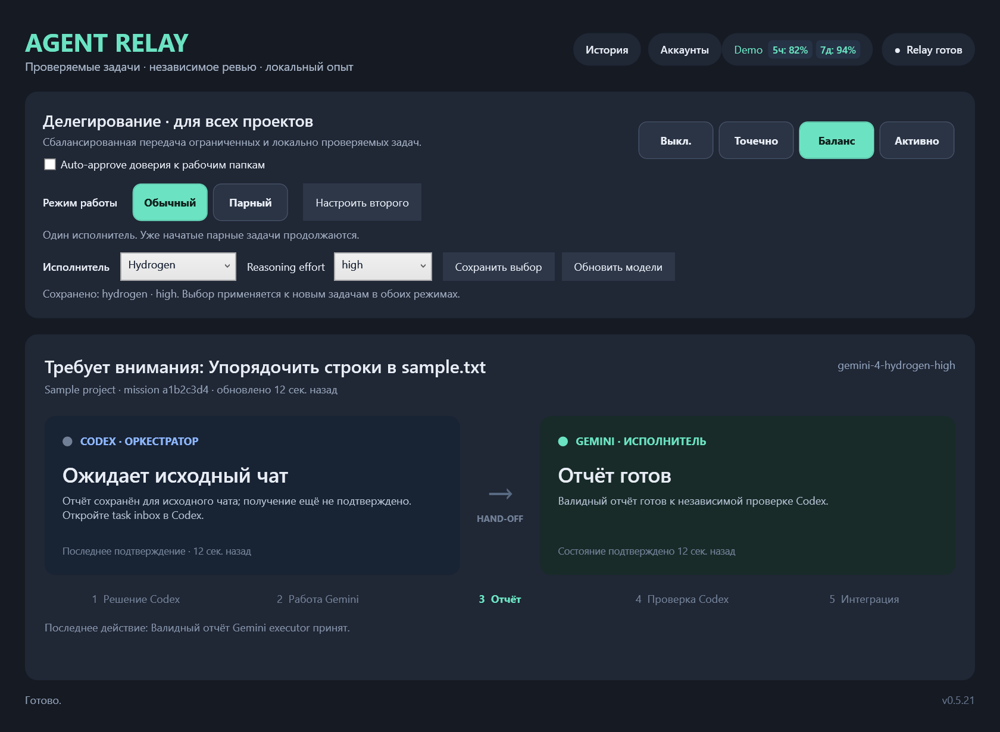

<h1> Agent Relay</h1>

**Hand off a bounded coding task from Codex to Google Antigravity.** Agent Relay shows the handoff status. The Codex chat that started the task can pick up the report and check the changes before integrating them.

**Передавайте отдельные задачи из Codex в Google Antigravity.** Relay показывает ход работы. Из исходного чата Codex можно забрать отчёт и проверить изменения.

**[Download for Windows / Скачать для Windows](https://github.com/korzhy/agent-relay-downloads/releases/latest/download/AgentRelaySetup-x64.exe)** · Windows 10/11 x64 · .NET included

[Русская версия](README.ru.md) · [English guide](docs/guide.md) · [Руководство на русском](docs/guide.ru.md) · [What’s new](https://github.com/korzhy/agent-relay-downloads/releases/latest)

**Before you start:** install and sign in to the Codex desktop app. Install the Google Antigravity CLI (`agy`) separately and have a Google account with Antigravity access. The Relay installer is currently unsigned. [Verify the download](docs/guide.md#verify-the-installer).

**First run:** install Relay under your Windows user, connect your Google account in **Аккаунты** (Accounts), then open a new Codex chat in a practice repository. [Follow the setup steps](docs/guide.md#set-up-and-try-a-task).

*Agent Relay 0.5.21 with synthetic data. The executor’s report is ready. The originating Codex chat still needs to pick it up and review it.*

## What you can do

- **Choose how often Codex delegates.** Use the delegation threshold to turn handoffs off, reserve them for clear mechanical work, or let Codex consider more tasks with clear checks. Approve access for a specific workspace when you first need it.
- **Follow a handoff.** See whether the executor is working, waiting, or has produced a report. Pick up and check the result in the original Codex chat.
- **Run independent tasks in parallel.** Normal mode uses one executor. Optional Paired mode supports a second configured Windows user, with separate workspaces for independent tasks. Codex checks each result before integrating changes.

## Updates and help

- **Updates.** When Relay offers an update, click **Обновить** (Update) after active work finishes. Relay verifies the download, installs it, and restarts. [Update or reinstall manually](docs/guide.md#update-relay).
- **Troubleshooting.** Open **Диагностика** (Diagnostics) from the Relay status button to check whether Codex and Antigravity are ready. [Troubleshooting and support](docs/guide.md#troubleshooting).

This repository hosts the official installers, checksums, and user guides.
