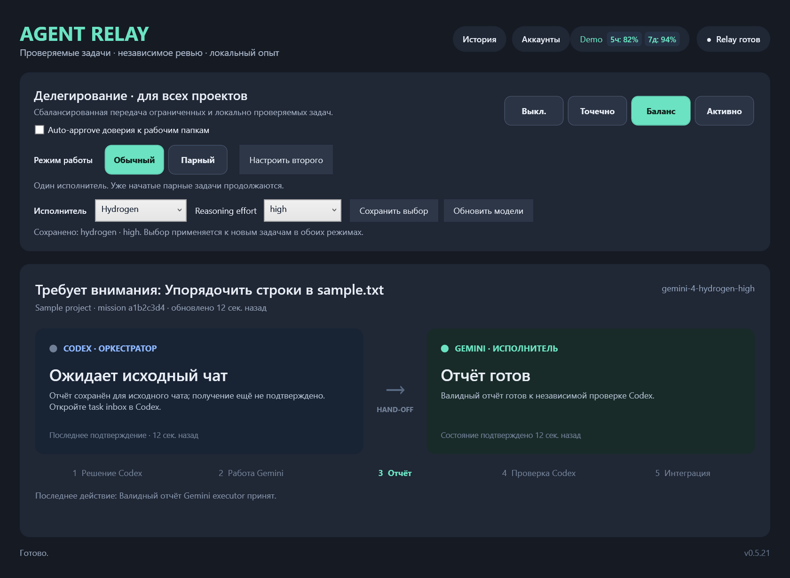

<h1> Agent Relay</h1>

**Продолжайте работу в Codex, пока Gemini выполняет отдельную задачу.** Relay запускает исполнителя в Windows и показывает, как идёт работа. Когда результат готов, Codex может забрать отчёт в том же чате, проверить изменения и решить, что включить в проект.

**[Скачать Agent Relay для Windows](https://github.com/korzhy/agent-relay-downloads/releases/latest/download/AgentRelaySetup-x64.exe)** · Windows 10/11 x64 · .NET в комплекте

[English overview](README.md) · [Руководство на русском](docs/guide.ru.md) · [English guide](docs/guide.md) · [Что нового](https://github.com/korzhy/agent-relay-downloads/releases/latest)

**Окно Antigravity можно оставить закрытым.** Установите Antigravity CLI (`agy`) и подключите аккаунт Google с доступом к моделям. Relay сам запустит CLI, когда понадобится. [Настройка и первая задача](docs/guide.ru.md#настройка-и-первая-задача) · [Проверка установщика](docs/guide.ru.md#проверка-установщика)

## Как это работает в проекте

- **Поручите Hydrogen целую часть работы.** Пока Codex исправляет ошибку в интерфейсе, Hydrogen High может добавить новое поле в импорт CSV, обновить проверку данных и убедиться, что старые файлы по-прежнему импортируются. Выберите порог **Баланс** или **Активно**, чтобы Codex рассматривал такие задачи, когда результат можно проверить.
- **Выберите модель и усилие.** По умолчанию работает **Hydrogen High**, также доступен **Flash High**. С версии 0.5.22 в режиме **Авто** Codex может выбирать для Hydrogen Low, Medium или High под каждую задачу. Порог определяет, когда Codex рассматривает передачу задачи. Усилие определяет глубину работы Hydrogen над ней.
- **Запустите две независимые задачи одновременно.** В парном режиме можно подключить второго пользователя Windows. Каждый исполнитель работает в своей копии, поэтому задачи можно брать из одного репозитория. Codex проверяет каждый результат перед интеграцией.

*Пример задачи в Relay 0.5.21. Gemini закончил работу, отчёт готов для Codex.*

## Обновления и помощь

- **Обновляйтесь из Relay.** Когда появится кнопка **Обновить**, нажмите её. Relay проверит скачанный файл, установит обновление и перезапустится. Если задача ещё выполняется, нажмите кнопку после её завершения. [Ручное обновление](docs/guide.ru.md#обновление-relay)
- **Проверьте, чего не хватает.** Откройте **Диагностику** через кнопку состояния Relay. Она подскажет, доступны ли Codex, CLI и нужная модель. [Типичные проблемы](docs/guide.ru.md#если-что-то-не-работает)
